# 12. 화면 테스트 가이드

> 처음 보는 사람이 이 문서만 보고 애플리케이션을 실행하고, 브라우저 화면에서 시나리오 16개(F-1~F-16)를 직접 확인할 수 있도록 정리했습니다.
> 화면 설계와 각 동작의 근거는 [`11-frontend-design.md`](11-frontend-design.md)를 봅니다. 스크린샷은 2026-10-13에 이 절차대로 실행해 찍었습니다.

## 0. 한눈에 보기

| 단계 | 데이터 | 시나리오 | 소요 |
|---|---|---|---|
| [1. 준비](#1-준비) | - | - | 1분 |
| [2. 실행 A — 샘플 데이터](#2-실행-a--샘플-데이터-usertxt) | 저장소의 `user.txt` (읽기만 함) | F-1~F-7, F-10, F-13~F-16 | 5분 |
| [3. 실행 B — 데모 데이터](#3-실행-b--데모-데이터) | 임시 디렉터리의 데모 파일 (만들고 바꾸고 지움) | F-8, F-9, F-11, F-12 | 5분 |
| [4. 정리](#4-정리) | - | - | - |

- **원본 `user.txt`는 수정하지 않습니다.** 파일을 바꾸거나 지우는 시나리오는 모두 3절의 데모 파일로 합니다
- 명령은 macOS·Linux 셸 기준입니다. Windows는 Git Bash나 WSL에서 같은 명령을 씁니다

## 1. 준비

JDK 21이 필요합니다. Gradle은 저장소에 포함된 wrapper(`./gradlew`)가 내려받으므로 따로 설치하지 않습니다.

```bash
java -version
```

`21`로 시작하는 버전이 나오면 됩니다. 저장소 루트(`build.gradle`이 있는 디렉터리)에서 이후 명령을 실행합니다.

## 2. 실행 A — 샘플 데이터 (`user.txt`)

### 2.1 서버 시작

```bash
./gradlew bootRun
```

아래 로그가 보이면 준비된 것입니다. 샘플 데이터는 정상 37건, 파싱 실패 3건(16·31·39행)입니다.

```
INFO  user.txt 적재 완료 - path=.../user.txt, success=37, failure=3
INFO  Tomcat started on port 8080 ...
```

브라우저에서 **http://localhost:8080/** 을 엽니다.

> **8080 포트를 이미 다른 프로그램이 쓰고 있다면** 기동이 실패하거나, 브라우저에 이 앱이 아닌 다른 응답이 보입니다(예: `{"code":"AUTHENTICATION_REQUIRED",...}`). 이 앱의 에러 응답은 항상 `title`, `status`, `detail`, `code` 필드를 갖습니다. 포트를 바꿔 실행하고, 이후 문서의 `8080`을 바꾼 번호로 읽습니다.
>
> ```bash
> SERVER_PORT=8081 ./gradlew bootRun
> ```

### F-1. 첫 화면

| 할 일 | 기대 결과 |
|---|---|
| http://localhost:8080/ 접속 | 헤더에 `적재 시각`, 표에 1001~1010, `전체 37건`, `1 / 4 페이지`, `파싱 실패` 탭에 빨간 `3` |

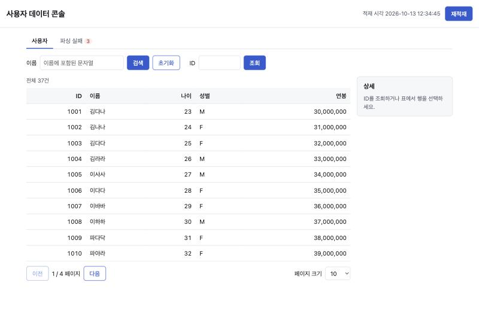

### F-2. 페이지 이동

| 할 일 | 기대 결과 |
|---|---|
| `다음`을 세 번 누름 | `4 / 4 페이지`, 7건(1033~1040, 실패 행 1039 없음), `다음` 비활성, 주소창 `?page=3` |
| `페이지 크기`를 `20`으로 변경 | `1 / 2 페이지`로 돌아가고 20건 표시 |

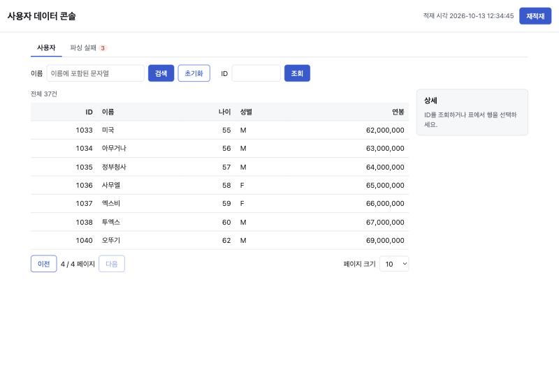

### F-3. 이름 검색과 초기화

| 할 일 | 기대 결과 |
|---|---|
| 이름 칸에 `파이` 입력 → `검색` | `'파이' 검색 결과 2건` (1011 파이리, 1013 파이추), 주소창 `?name=파이` |
| `초기화` | 검색어가 지워지고 `전체 37건` |

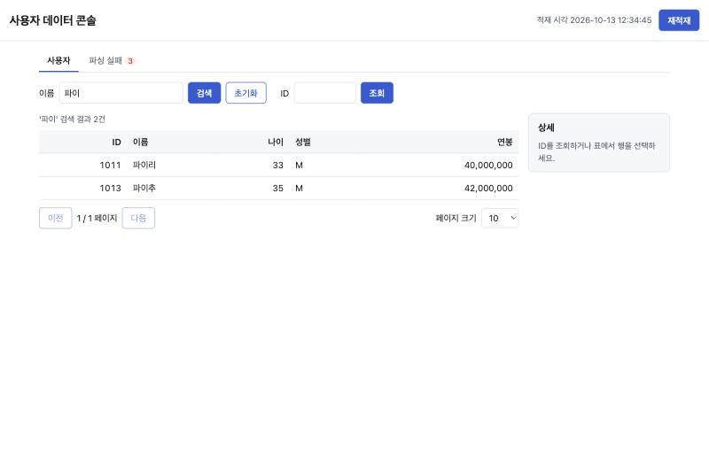

### F-4. ID 조회와 행 선택

| 할 일 | 기대 결과 |
|---|---|
| ID 칸에 `1017` 입력 → `조회` | 오른쪽 상세 패널에 1017 / 치킨 / 39 / M / 46,000,000 |
| 표의 아무 행이나 클릭 | 그 사용자의 상세가 표시되고 행이 강조됨 |

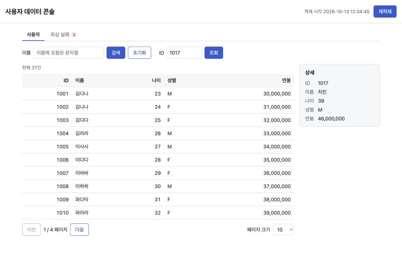

### F-5. 없는 ID 조회 (에러 표시)

| 할 일 | 기대 결과 |
|---|---|
| ID 칸에 `9999` 입력 → `조회` | 빨간 알림 `ID 9999에 해당하는 사용자가 없습니다. (USER_NOT_FOUND)`, 상세 패널 `사용자를 찾을 수 없습니다.` |

알림 문구는 서버 에러 응답의 `detail`과 `code`를 그대로 보여 준 것입니다.

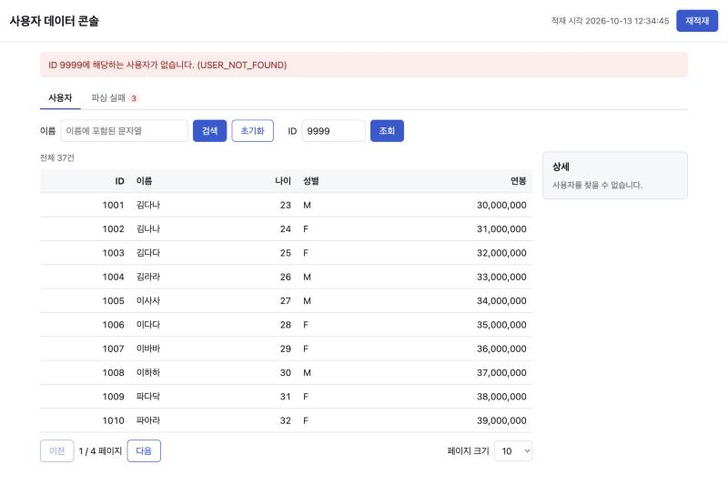

### F-6. 파싱 실패 탭

| 할 일 | 기대 결과 |
|---|---|
| `파싱 실패` 탭 클릭 | 3건: 16행 `INVALID_SALARY`(영문 O), 31행 `INVALID_FIELD_COUNT`(빈 필드), 39행 `INVALID_SALARY`(AAA). 원본 행이 고정폭 글꼴로 그대로 표시. 이전 알림은 사라짐 |

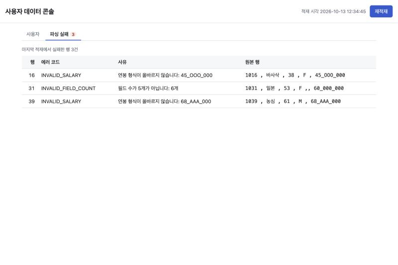

### F-7. 재적재

| 할 일 | 기대 결과 |
|---|---|
| `사용자` 탭으로 돌아가 오른쪽 위 `재적재` | 초록 알림 `재적재 완료: 성공 37건, 실패 3건`, 헤더의 적재 시각 갱신 |

파일 내용을 바꾸지 않고 다시 읽기만 하므로 원본에 영향이 없습니다.

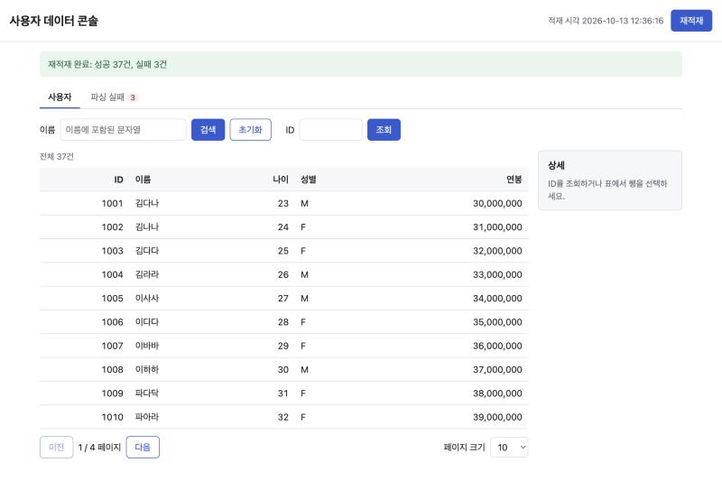

### F-10. 모바일 폭

| 할 일 | 기대 결과 |
|---|---|
| Chrome 개발자 도구(`F12` 또는 `⌥⌘I`) → 기기 툴바(`Ctrl+Shift+M` / `⇧⌘M`) → iPhone 등 375px 폭 선택 | 가로 스크롤 없이 표시. 검색·ID 입력이 줄바꿈되고, 상세 패널은 표 아래로 내려감 |

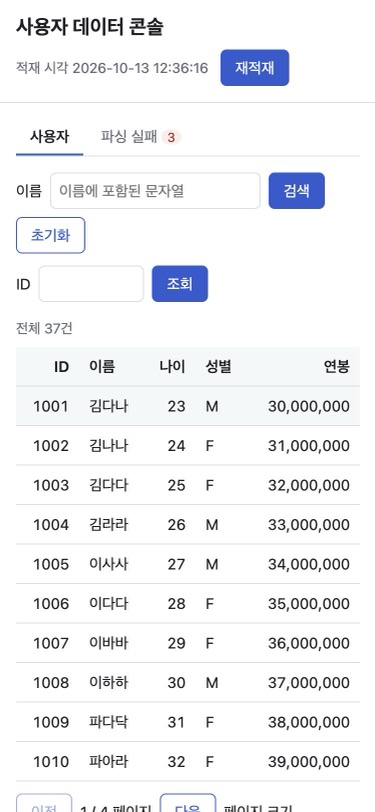

### F-13~F-16. 주소(URL)로 상태 확인

화면 상태(탭·검색어·페이지·페이지 크기)는 주소창 쿼리에 남습니다. `page`는 API와 같이 **0부터** 셉니다 (`?page=2`가 화면의 `3 / 4 페이지`).

| # | 할 일 | 기대 결과 |
|---|---|---|
| F-13 | 주소창에 `localhost:8080/?page=2` 입력 → `다음` → 브라우저 뒤로 가기 | `3 / 4 페이지`(첫 행 1022) → 주소 `?page=3`, `4 / 4` → 다시 `?page=2`, `3 / 4` |
| F-14 | `localhost:8080/?name=김&size=20&tab=failures` 입력 → `사용자` 탭 → 뒤로 가기 | 파싱 실패 탭이 열리고 검색창 `김`, 페이지 크기 `20` → `'김' 검색 결과 5건`, 주소에서 `tab=failures` 사라짐 → 다시 파싱 실패 탭 |
| F-15 | `localhost:8080/?page=-1&size=7&tab=zzz` 입력 | 에러 없이 기본 화면(`1 / 4`, 크기 10). 주소가 `localhost:8080/`로 바뀜 |
| F-16 | `localhost:8080/?page=99&size=50` 입력, 이어서 `localhost:8080/?page=99999999999` 입력 | 각각 마지막 페이지(주소 `?size=50`), 첫 페이지(주소 `/`)로 보정. 에러 알림 없음 |

F-13 직접 접속 화면 (`?page=2`):


F-14에서 `사용자` 탭으로 전환한 화면 (`?name=김&size=20`):

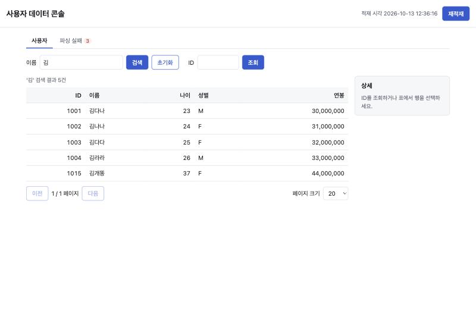

F-15·F-16은 화면이 기본 화면·마지막 페이지와 같으므로, **주소창이 보정되는지**를 확인합니다.

실행 A를 마치면 서버 터미널에서 `Ctrl+C`로 종료합니다.

## 3. 실행 B — 데모 데이터

데이터 파일을 만들고, 바꾸고, 지우는 시나리오입니다. 원본 대신 `/tmp/user-api-demo/user.txt`를 데이터 파일로 지정합니다. **터미널 두 개**를 씁니다: 하나는 서버, 하나는 파일 조작.

### 3.1 서버 시작 (터미널 1)

데모 디렉터리를 비운 상태, 즉 **데이터 파일이 없는 상태로** 시작합니다.

```bash
mkdir -p /tmp/user-api-demo && rm -f /tmp/user-api-demo/user.txt
USER_API_DATA_FILE_PATH=/tmp/user-api-demo/user.txt ./gradlew bootRun
```

`기동 시 사용자 데이터 적재 실패 - 빈 데이터로 시작합니다` ERROR 로그가 나오는 것이 정상입니다. 파일이 없어도 애플리케이션은 빈 데이터로 기동합니다.

### F-11. 데이터 없이 기동

| 할 일 | 기대 결과 |
|---|---|
| http://localhost:8080/ 접속 | 헤더에 주황색 `데이터가 적재되지 않았습니다`, 표에 `결과가 없습니다.`, `전체 0건` |

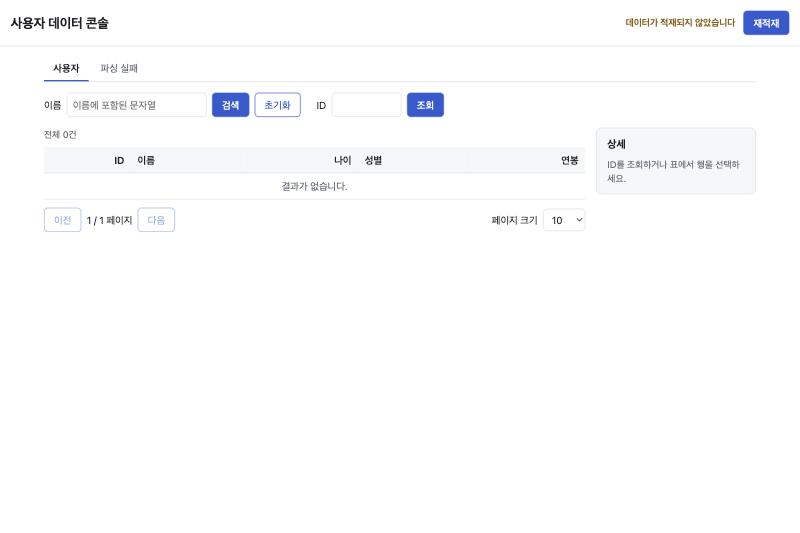

### F-9. 데이터 속 HTML이 실행되지 않음

데이터 파일 원문에 HTML이 들어 있어도 화면은 문자 그대로 보여 줘야 합니다.

**터미널 2**에서 데모 파일을 만듭니다.

```bash
cat > /tmp/user-api-demo/user.txt <<'EOF'
2001 , 데모사용자 , 30 , M , 1_000_000
2002 ,  , 31 , F , 2_000_000
2003 , <b>굵게</b> , 32 , X , 3_000_000
EOF
```

| 할 일 | 기대 결과 |
|---|---|
| 브라우저에서 `재적재` | `재적재 완료: 성공 2건, 실패 1건`. 2002의 이름이 `` **글자 그대로** 표시되고, 경고창(alert)이 뜨지 않음 |
| `파싱 실패` 탭 | 3행 `INVALID_GENDER`(성별 X), 원본 행의 `<b>굵게</b>`가 굵은 글씨가 아닌 **글자 그대로** 표시 |

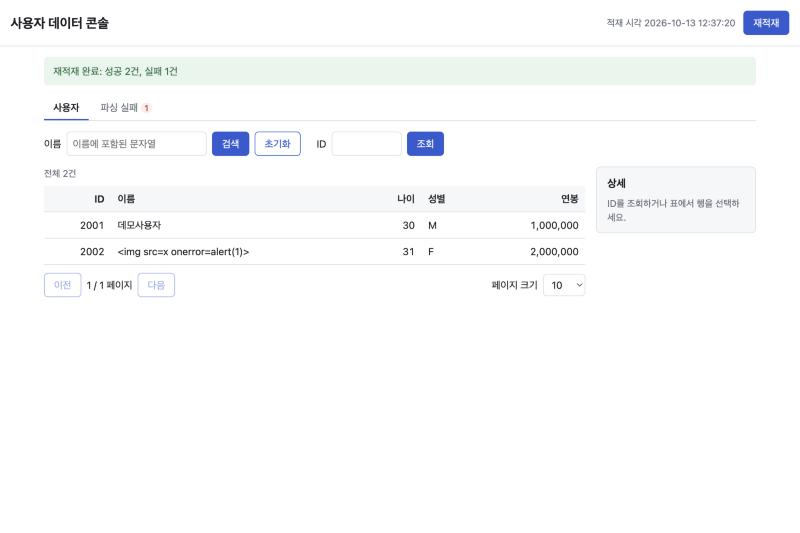

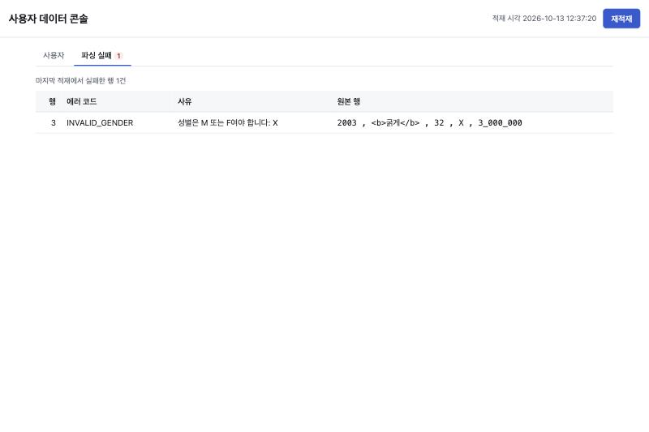

### F-12. 재적재로 데이터가 줄었을 때 페이지 보정

**터미널 2**에서 25건 파일을 만듭니다.

```bash
for i in $(seq 1 25); do echo "$((3000+i)) , 데모$i , 30 , M , 1_000_000"; done > /tmp/user-api-demo/user.txt
```

| 할 일 | 기대 결과 |
|---|---|
| `사용자` 탭에서 `재적재` → `다음` 두 번 | `3 / 3 페이지`, 3021~3025 (아래 왼쪽 그림) |

이어서 **터미널 2**에서 5건으로 줄입니다.

```bash
for i in $(seq 1 5); do echo "$((4000+i)) , 축소$i , 30 , F , 1_000_000"; done > /tmp/user-api-demo/user.txt
```

| 할 일 | 기대 결과 |
|---|---|
| 3페이지를 보는 채로 `재적재` | `재적재 완료: 성공 5건, 실패 0건`, 빈 3페이지가 아니라 마지막 페이지 `1 / 1`로 이동(4001~4005), 주소에서 `page` 사라짐 |

| 재적재 전 (25건, 3페이지) | 재적재 후 (5건, 1페이지로 이동) |
|---|---|
| 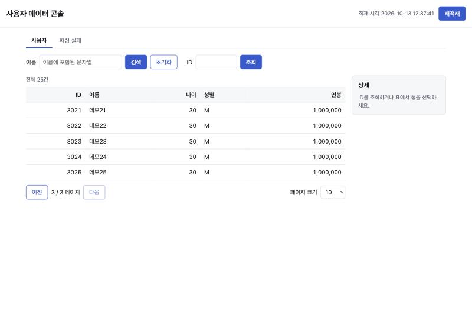 | 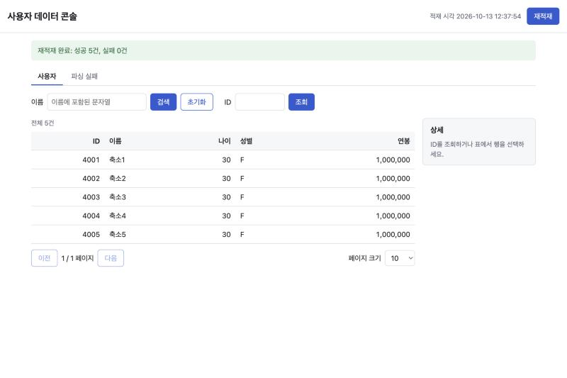 |

### F-8. 재적재 실패 시 기존 데이터 유지

**터미널 2**에서 데이터 파일을 지웁니다.

```bash
rm /tmp/user-api-demo/user.txt
```

| 할 일 | 기대 결과 |
|---|---|
| `재적재` | 빨간 알림 `사용자 데이터 파일을 읽을 수 없어 기존 데이터를 유지합니다. (DATA_LOAD_FAILED)`. 표는 직전 데이터(4001~4005, `전체 5건`)를 그대로 보여 줌 |

알림에 서버의 파일 경로가 나오지 않는 것도 확인합니다 (경로는 서버 로그에만 남습니다).

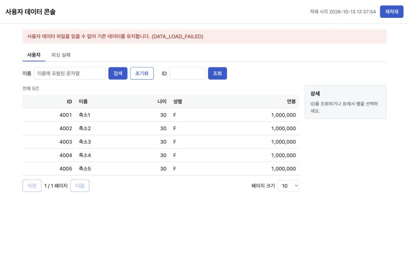

## 4. 정리

```bash
# 터미널 1에서 Ctrl+C로 서버 종료 후
rm -rf /tmp/user-api-demo
```

## 5. 결과 기록표

직접 확인하면서 체크합니다.

| # | 시나리오 | 데이터 | 확인 |
|---|---|---|---|
| F-1 | 첫 화면 | 샘플 | ☐ |
| F-2 | 페이지 이동, 크기 변경 | 샘플 | ☐ |
| F-3 | 이름 검색·초기화 | 샘플 | ☐ |
| F-4 | ID 조회·행 선택 | 샘플 | ☐ |
| F-5 | 없는 ID → `USER_NOT_FOUND` | 샘플 | ☐ |
| F-6 | 파싱 실패 탭 | 샘플 | ☐ |
| F-7 | 재적재 성공 | 샘플 | ☐ |
| F-8 | 파일 삭제 후 재적재 → `DATA_LOAD_FAILED`, 기존 데이터 유지 | 데모 | ☐ |
| F-9 | 데이터 속 HTML이 글자 그대로 표시 | 데모 | ☐ |
| F-10 | 모바일 폭 | 샘플 | ☐ |
| F-11 | 데이터 없이 기동 → 미적재 경고 | 데모 | ☐ |
| F-12 | 데이터 축소 후 페이지 보정 | 데모 | ☐ |
| F-13 | `?page=2` 직접 접속, 뒤로 가기 | 샘플 | ☐ |
| F-14 | 검색어·크기·탭이 URL에서 복원 | 샘플 | ☐ |
| F-15 | 잘못된 쿼리 보정 | 샘플 | ☐ |
| F-16 | 범위 밖·int 초과 page 보정 | 샘플 | ☐ |

## 6. 문제 해결

| 증상 | 원인 | 해결 |
|---|---|---|
| `Port 8080 was already in use`로 기동 실패, 또는 브라우저에 이 앱이 아닌 JSON | 다른 프로그램이 8080 사용 중 | `lsof -i :8080`으로 확인. `SERVER_PORT=8081 ./gradlew bootRun` |
| `Unsupported class file major version`, 컴파일 오류 | JDK 버전이 21이 아님 | `java -version` 확인 후 JDK 21 사용 (`JAVA_HOME` 지정) |
| 화면 파일(`static/*`)을 고쳤는데 반영이 안 됨 | `bootRun`은 빌드된 리소스를 제공 | 서버를 재시작 |
| 표가 흐릿하게 멈춰 있음 | 요청 중(`aria-busy`). 서버가 꺼졌으면 `서버에 연결할 수 없습니다.` 알림 | 서버 터미널 확인 |
| F-11에서 미적재 경고가 안 나옴 | `/tmp/user-api-demo/user.txt`가 남아 있음 | 3.1의 `rm -f`를 실행하고 서버 재시작 |
